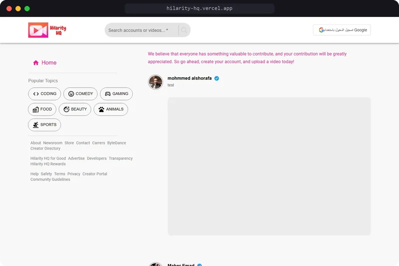
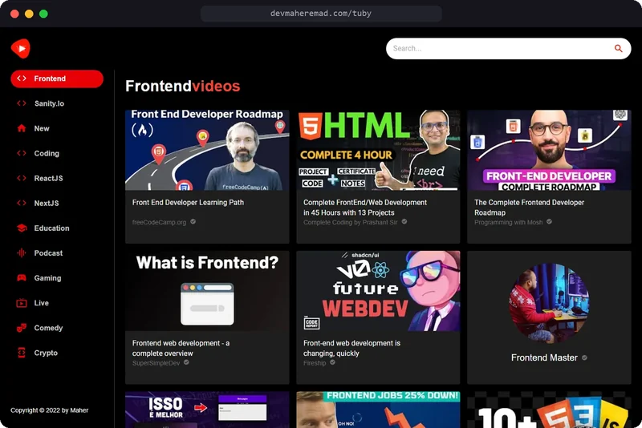
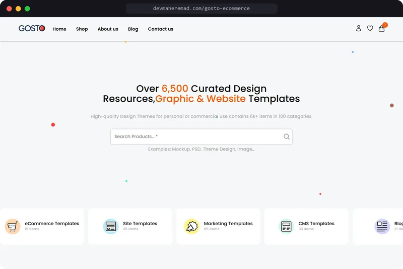
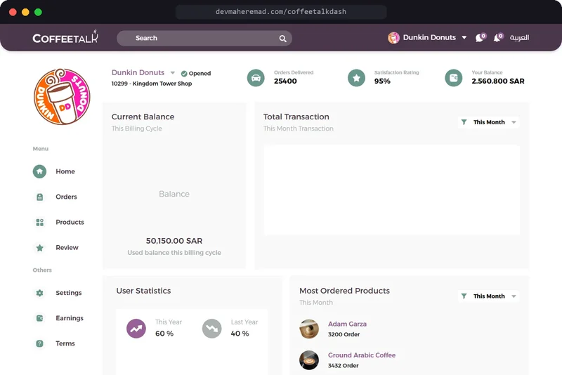
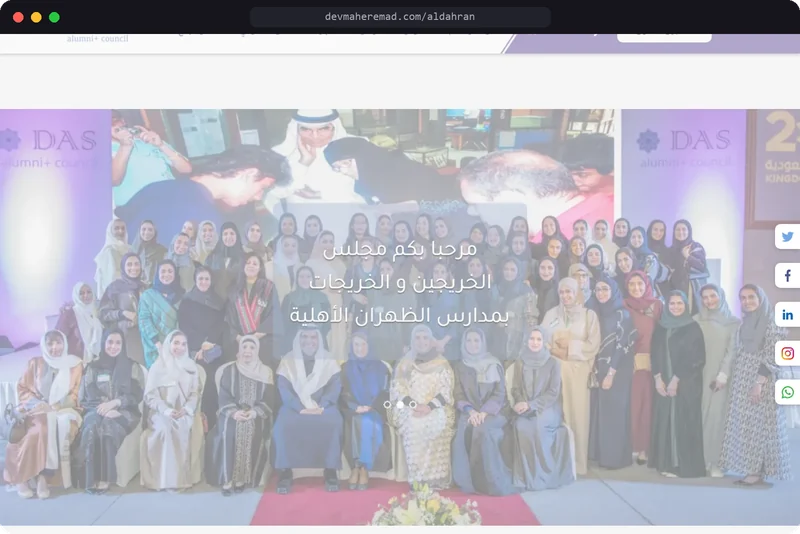
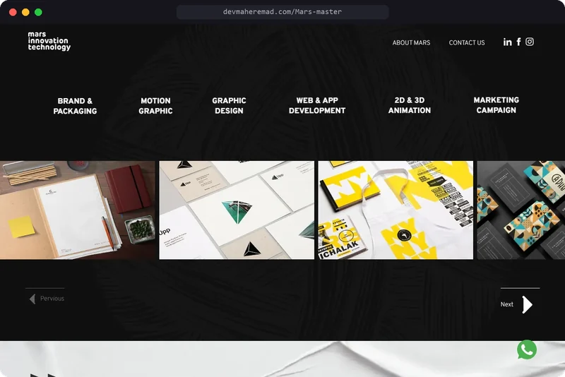

<a href="https://devmaheremad.com">
  <picture>
    <source media="(prefers-color-scheme: dark)" srcset="./assets/banner-dark.svg">
    <source media="(prefers-color-scheme: light)" srcset="./assets/banner-light.svg">
    
  </picture>
</a>

  
  
  
  
  

### Hi, I'm Maher 👋

I build fast, accessible **React** and **Next.js** frontends for **SaaS, e-commerce and booking** products. 5+ years, remote.
I took an app from about **55% to 95%+ on Lighthouse**, built a **FIFA World Cup Qatar 2022** ticket-booking experience, and argued for **Next.js** as the foundation of a multi-store SaaS platform. I care about the decisions behind the pixels.

<picture>
  <source media="(prefers-color-scheme: dark)" srcset="./assets/impact-dark.svg">
  <source media="(prefers-color-scheme: light)" srcset="./assets/impact-light.svg">
  
</picture>

## ⚡ Case studies

<table>
  <tr>
    <td width="33%" valign="top">
      <b>From ~55% to 95%+ on Lighthouse</b> 
      The Sailors · React · TypeScript  
      Traced the slowdown to unoptimized images, a heavy JavaScript bundle and render-blocking fonts. Fixed imports, split routes, sized images and changed font loading. Storefronts then shipped at 95%+ on every Lighthouse category.
    </td>
    <td width="33%" valign="top">
      <b>World Cup Qatar 2022 ticket booking</b> 
      The Sailors · React · Material UI  
      Proposed building it inside the existing platform instead of a new site, which cut the scope under a tight deadline. Kept the booking path minimal for traffic peaks. It supported about $20,000 in revenue per match event.
    </td>
    <td width="33%" valign="top">
      <b>Choosing Next.js for a SaaS platform</b> 
      Konin Cloud · Next.js · TypeScript  
      The first plan was HTML, Sass and Blade. I wrote a technical comparison of both approaches (architecture, trade-offs, maintainability, SEO) that supported the team's move to Next.js for KoninPay.
    </td>
  </tr>
</table>

<a href="https://devmaheremad.com/#case-studies"><b>Read the full case studies →</b></a>

## 🚀 Selected work

<table>
  <tr>
    <td width="50%" valign="top">
      
      <b>Hilarity HQ</b> · video sharing platform 
      Next.js · TypeScript · Redux Toolkit · Material UI 
      <a href="https://hilarity-hq.vercel.app">Live</a> · <a href="https://github.com/devmaheremad/hilarity-hq">Code</a>
    </td>
    <td width="50%" valign="top">
      
      <b>Tuby</b> · data-driven video browser 
      React · TypeScript · Zustand · React.lazy + Suspense 
      <a href="https://devmaheremad.com/tuby/">Live</a> · <a href="https://github.com/devmaheremad/tuby">Code</a>
    </td>
  </tr>
  <tr>
    <td width="50%" valign="top">
      
      <b>Gosto Modern Ecommerce</b> · storefront 
      React · TypeScript · Material UI · Swiper 
      <a href="https://devmaheremad.com/gosto-ecommerce/">Live</a> · <a href="https://github.com/devmaheremad/gosto-ecommerce">Code</a>
    </td>
    <td width="50%" valign="top">
      
      <b>Coffee Talk</b> · business dashboard 
      JavaScript · Bootstrap · Chart.js 
      <a href="https://devmaheremad.com/coffeetalkdash/home">Live</a>
    </td>
  </tr>
  <tr>
    <td width="50%" valign="top">
      
      <b>Dhahran Schools</b> · education website 
      HTML · Sass · JavaScript 
      <a href="https://devmaheremad.com/aldahran">Live</a>
    </td>
    <td width="50%" valign="top">
      
      <b>Mars Technology</b> · company website 
      HTML · Sass · JavaScript 
      <a href="https://devmaheremad.com/Mars-master">Live</a> · <a href="https://github.com/devmaheremad/Mars-master">Code</a>
    </td>
  </tr>
</table>

**Live storefronts on the KoninPay platform:** [Digits](https://digits.koninstore.com/en) · [Market](https://market.koninstore.com/en) · [Food](https://foodstore.koninstore.com/en) · [Fashion](https://fashion.koninstore.com/en) · [Glammart](https://glammart.koninstore.com/en) · [Gearup](https://gearup.koninstore.com/en) · [Pastries](https://pastryshop.koninstore.com/en)
More: [AJAD FM](https://devmaheremad.com/ajad) · [Creative Laqta](https://devmaheremad.com/laqtasiteloader) · [everything on devmaheremad.com →](https://devmaheremad.com/#projects)

## 💼 Experience

| Role | Company | When | Highlights |
|---|---|---|---|
| **Senior Frontend Developer** | Konin Cloud · Remote | May 2023 – Sep 2025 | Multi-store SaaS (KoninPay): Next.js decision and written comparison, reusable UI from Figma, REST APIs, RTL + integration + E2E tests |
| **Senior Frontend Developer** | The Sailors · Saudi Arabia, remote | Jan 2022 – Dec 2023 | World Cup 2022 booking (~$20K per match event), ~55% → 95%+ Lighthouse, storefronts at 95%+ on every category |
| **Frontend Developer** | Mars Innovation Technology · UAE, remote | Jan 2021 – Dec 2021 | End-to-end frontend owner of the Beljwar booking platform, 20+ Figma/XD screens, 10+ booking and business websites |
| **Internship Trainee** | Gaza Sky Geeks · Palestine | Jan 2020 – Aug 2020 | JavaScript, HTML5, CSS3 and modern frontend practices |

## 🧰 Toolbox

  <picture>
    <source media="(prefers-color-scheme: light)" srcset="https://skillicons.dev/icons?i=react,nextjs,ts,js,redux,materialui,tailwind,sass,html,css,bootstrap,git,github,figma,firebase,xd&theme=light&perline=16">
    
  </picture>

**Also:** Zustand · React Testing Library · Core Web Vitals · Lighthouse · Accessibility (WCAG) · PWA · SEO · REST APIs · Sanity.io

## 🧭 How I work

- **Performance is checked before merge**, not after launch: Lighthouse runs before merging, so new features can't quietly pull scores down.
- **Decisions are written down.** Before picking a stack I compare the options: architecture, trade-offs and maintainability.
- **Accessible (WCAG) and cross-browser by default**, with structured loading and error states on API-driven screens.
- **Tested where it matters:** React Testing Library, integration and end-to-end tests on critical user flows.

---

  <b>Open to Senior Frontend Engineer roles</b> · remote-first, also KSA, UAE and Europe · <b>available now</b> 
  <a href="mailto:hello@devmaheremad.com">hello@devmaheremad.com</a> · <a href="https://devmaheremad.com">devmaheremad.com</a> · <a href="https://www.linkedin.com/in/devmaheremad">LinkedIn</a> · <a href="https://linktr.ee/devmaheremad">All links</a>

